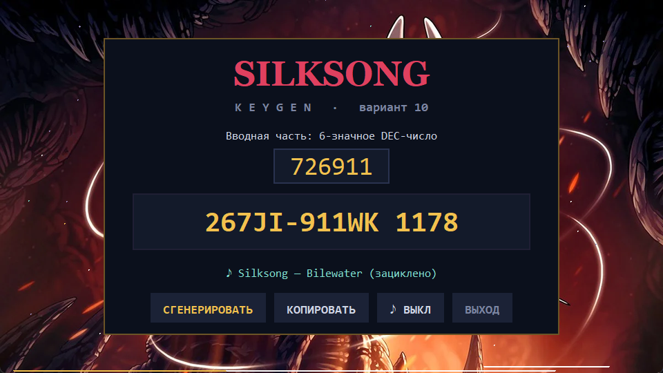

# Лабораторная работа №3 — вариант 10

**Студент:** Дейнекин Эльдар
**Игра:** Hollow Knight: Silksong

## Вариант

| Параметр | Значение |
|---|---|
| Вводная часть | DEC-число из 6 цифр |
| Формат ключа | `XXXXX-XXXXX XXXX` |
| Правило | 1-й и 2-й блоки содержат цифры введённого числа, остальное — случайные буквы; 3-й блок — сумма чисел из 1-го и 2-го блоков |

Пример из задания: ввод `726911` → `276DL-191GO-0467`
(276 + 191 = 467, третий блок дополняется нулями слева до 4 цифр).

> В тексте задания блоки описаны как «4,5,6 и 1,2,3 цифры», но в примере
> первый блок содержит именно первые три цифры (`276` — это перемешанные `726`),
> а второй — последние три (`191` — перемешанные `911`), и сумма `276 + 191 = 467`
> даёт `0467`. Реализация следует примеру.

## Что сделано

| Файл | Назначение |
|---|---|
| `main.py` | GUI на tkinter (окно 960×540): фон-арт, поле ввода, поле ключа, кнопки, анимация, музыка |
| `keygen.py` | чистая логика генерации (`generate_key`), валидация ввода, не зависит от tkinter |
| `make_background.py` | подготовка фона: ресайз арта под окно и мягкое затемнение под панелью |
| `make_assets.py` | запасные ресурсы, если основных нет: `background_generated.png` и `theme_generated.wav` (8-бит) |
| `tests/test_keygen.py` | 10 юнит-тестов на формат ключа и правило суммы |
| `docs/screenshot.png` | как выглядит окно |

## Ресурсы (папка `assets/`)

| Файл | Что это |
|---|---|
| `new-bg.webp` | исходный арт 1200×675 (загружен пользователем) |
| `background.png` | фон окна 960×540: арт, подогнанный по размеру и затемнённый в центре под панель |
| `theme.wav` | музыка Silksong OST «Bilewater» (2:17), mp3 → WAV 44.1 кГц, моно, 16 бит |
| `background_generated.png` | запасной фон, нарисованный программно |
| `theme_generated.wav` | запасная 8-битная мелодия, синтезированная программно |

Почему музыка в WAV: `winsound` воспроизводит **только WAV** (mp3 он не умеет).
Поэтому трек один раз перекодирован:

```bash
ffmpeg -i "21. Bilewater.mp3" -vn -map 0:a:0 -ac 1 -ar 44100 -c:a pcm_s16le assets/theme.wav
```

(`-vn` отбрасывает вложенную обложку альбома, `-ac 1` — моно, чтобы файл был втрое меньше.)

## Как работает генерация

1. Ввод проверяется: ровно 6 цифр (`keygen.validate_digits`).
2. Цифры 1–3 в случайном порядке + 2 случайные буквы `A-Z` → 1-й блок.
3. Цифры 4–6 в случайном порядке + 2 случайные буквы `A-Z` → 2-й блок.
4. Число из цифр 1-го блока складывается с числом из 2-го блока,
   результат форматируется как 4 цифры (`f"{total:04d}"`) → 3-й блок.

## Интерфейс и допзадание

* фон — тематический арт Silksong; в центре он мягко затемнён, чтобы панель
  с интерфейсом читалась, край панели обведён тонкой золотой линией;
* поле ввода принимает только цифры и не больше шести (`StringVar` + `trace_add`);
* поле ключа печатает ключ по символам, рамка пульсирует;
* анимация: 70 искр, поднимающихся вверх, и бегущая строка-развёртка
  (`root.after`, а не `time.sleep`, чтобы окно не замирало);
* музыка: кнопка «♪ ВКЛ/ВЫКЛ» запускает `assets/theme.wav` через `winsound`
  с зацикливанием (`SND_ASYNC | SND_LOOP`), остановка — `SND_PURGE`;
  на не-Windows кнопка честно сообщает, что `winsound` недоступен;
* кнопка «КОПИРОВАТЬ» кладёт ключ в буфер обмена, `Enter` — генерация, `Esc` — выход.



## Запуск

```bash
python main.py                     # запуск генератора
python keygen.py 726911            # проверка логики без GUI
python -m unittest discover tests  # тесты
python make_background.py          # пересобрать фон из assets/new-bg.webp (нужен Pillow)
python make_assets.py              # запасные фон и музыка (нужен Pillow)
```

Готовые `assets/*` уже лежат в репозитории, поэтому для запуска `main.py`
достаточно стандартной библиотеки Python с tkinter. Pillow нужен только
для скриптов подготовки оформления, а ffmpeg — только если перекодировать
новый трек из mp3.
